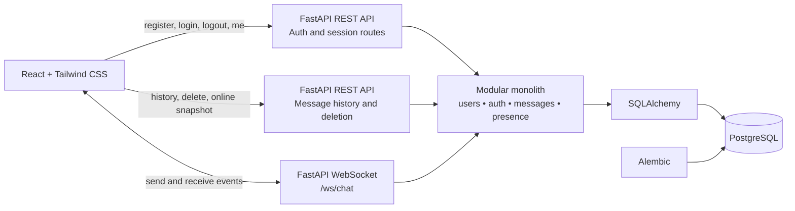

# SeisChat Architecture

## System Overview

SeisChat uses a modular monolith: one deployable FastAPI backend contains authentication, users, messages, and presence modules, while one React frontend provides the browser experience. PostgreSQL is the source of truth for users, sessions, and messages. A WebSocket connection carries live chat and presence events; REST endpoints handle authentication, message history, deletion, and an online-user snapshot.

The first release does not require microservices, a message broker, or a separate presence database. This keeps deployment and local development manageable for a six-member team.

## Component Interaction

## Frontend Architecture

The frontend should be organized by responsibility rather than by a single large component:

- **Pages and layouts**: registration, login, and the authenticated chatroom.
- **Reusable UI components**: message list, message composer, online-user list, and status/error feedback.
- **API client**: a small wrapper for the documented REST endpoints.
- **WebSocket client**: connection lifecycle, event parsing, reconnect behavior, and event dispatch.
- **Application state**: authenticated user, message history, connection state, online users, and errors.

Tailwind CSS supplies presentation utilities. The frontend must not duplicate server rules such as message ownership or username uniqueness; it should display server responses and errors.

## Backend Architecture

FastAPI is the HTTP and WebSocket entry point. The modular monolith should separate:

- **Auth module**: registration, login, logout, current-user lookup, and session validation.
- **Users module**: user representation and online presence projection.
- **Messages module**: message history, creation, ownership checks, and deletion.
- **WebSocket layer**: connection management, event validation, broadcasting, and disconnect handling.
- **Shared infrastructure**: configuration, database session management, SQLAlchemy models, and error types.

Routes should remain thin. Validation and business rules belong in service-level code, and database access belongs behind a consistent data-access pattern. The exact package layout is **TODO: Team Decision Required**.

## Database Layer

SQLAlchemy maps the documented `users`, `sessions`, and `messages` tables to Python models. Alembic owns schema migrations; schema changes must not be made manually in production databases. PostgreSQL enforces durable constraints such as unique usernames, foreign keys, and message ownership relationships.

Online presence is transient. The database design records sessions for authentication, while the active WebSocket connection manager maintains the live connected-user set in backend memory. The team must decide how presence behaves if multiple backend processes are introduced; multi-process coordination is outside the current MVP architecture.

## REST API Communication

The browser uses REST for request/response operations:

1. Register or authenticate a user.
2. Establish the authenticated frontend state.
3. Fetch previous messages and the current online-user snapshot.
4. Delete owned messages through the documented endpoint.

JSON response shapes and errors are defined in [api-contract.md](api-contract.md). Authentication uses a server-side session credential in a Secure, HttpOnly cookie. State-changing cookie-authenticated requests also require CSRF protection.

## WebSocket Communication

After authentication, the chatroom opens `/ws/chat`. The client sends a `send_message` event. The server validates the authenticated connection, persists the message, and broadcasts `new_message` to connected users. Deletion broadcasts `message_deleted`, and connection changes broadcast `online_users`.

The server is authoritative: clients must not treat a locally rendered message or presence state as confirmed until the corresponding server event arrives. Event schemas are defined in [websocket-events.md](websocket-events.md).

## Cross-Component Flow

### Sending a message

1. The authenticated client sends `send_message` over `/ws/chat`.
2. The backend validates the payload and connection identity.
3. The message is inserted into PostgreSQL.
4. The backend broadcasts `new_message` to all connected clients.
5. Clients append the server-provided message, including its ID and timestamp.

### Deleting a message

1. A client sends `DELETE /api/messages/{message_id}`.
2. The backend verifies that the requester owns the message and hard-deletes it.
3. The backend broadcasts `message_deleted` to connected clients.
4. All clients remove the message consistently.

## Approved decisions and remaining implementation details

- Session transport is a server-side session in a Secure, HttpOnly cookie.
- Passwords use Argon2id; only a hash of the session credential is stored.
- Messages use hard deletion.
- History uses cursor-based pagination.
- Backend package layout, supported runtime versions, cursor parameter limits, and multi-process presence coordination remain implementation details to document when selected. Multi-process coordination is outside V1.
