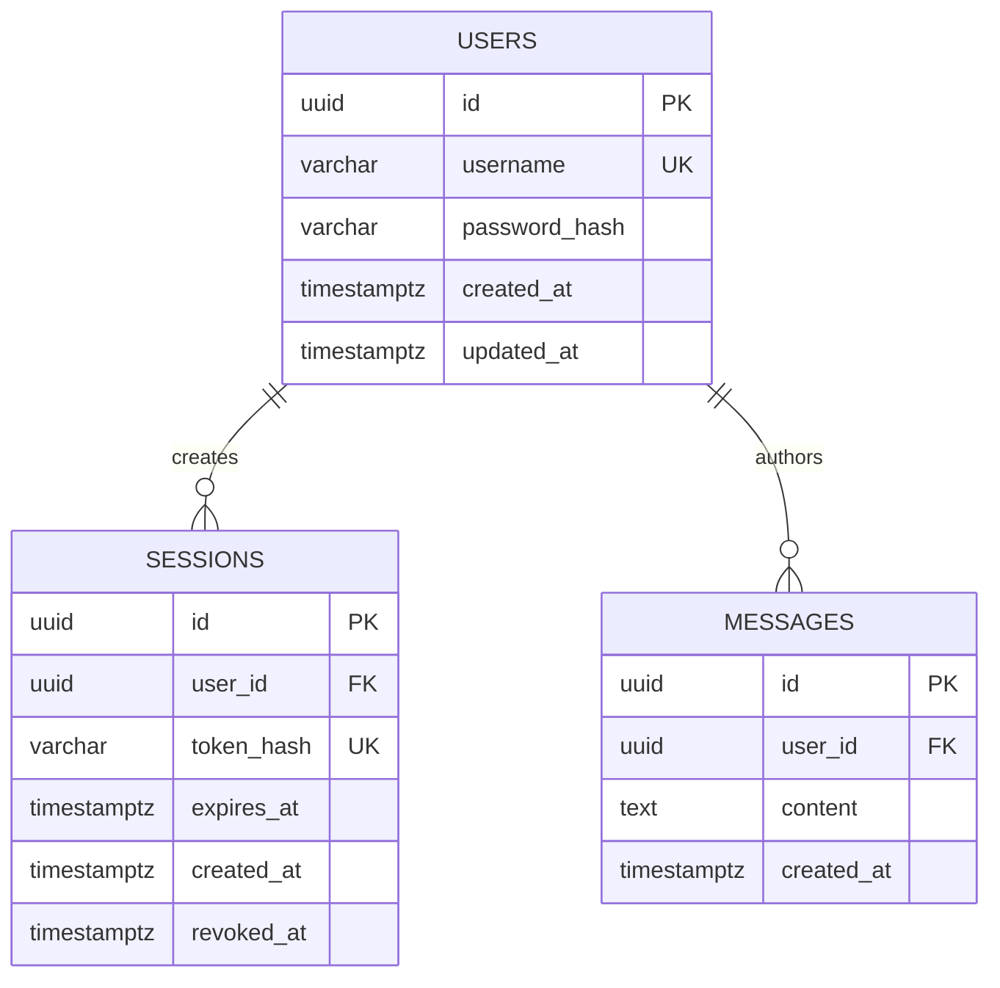

# SeisChat Database Design

PostgreSQL is the durable store for users, authentication sessions, and chat messages. SQLAlchemy provides the application mapping and Alembic manages schema migrations.

## Entity Relationship Diagram

## Tables

### `users`

Stores one record for each registered user.

| Column | Type | Constraints | Meaning |
| --- | --- | --- | --- |
| `id` | UUID | Primary key, generated | Stable user identifier |
| `username` | VARCHAR | Not null, unique | User-visible login/display name |
| `password_hash` | VARCHAR | Not null | One-way password hash; never plaintext |
| `created_at` | TIMESTAMPTZ | Not null, default | Registration time |
| `updated_at` | TIMESTAMPTZ | Not null, default | Last profile-record update |

Username normalization rules, maximum length, and case sensitivity are **TODO: Team Decision Required**. The uniqueness constraint must use the agreed normalization behavior.

### `sessions`

Stores server-recognized authenticated sessions. A session must reference one user and expire or be revoked before it can authenticate REST or WebSocket operations.

| Column | Type | Constraints | Meaning |
| --- | --- | --- | --- |
| `id` | UUID | Primary key, generated | Session identifier |
| `user_id` | UUID | Not null, foreign key to `users.id` | Session owner |
| `token_hash` | VARCHAR | Not null, unique | Hash of the session credential |
| `expires_at` | TIMESTAMPTZ | Not null | Session expiration time |
| `created_at` | TIMESTAMPTZ | Not null, default | Session creation time |
| `revoked_at` | TIMESTAMPTZ | Nullable | Logout/revocation time |

The raw credential is carried in a Secure, HttpOnly cookie. Only a hash should be stored in this table.

### `messages`

Stores messages sent in the single shared chatroom.

| Column | Type | Constraints | Meaning |
| --- | --- | --- | --- |
| `id` | UUID | Primary key, generated | Message identifier |
| `user_id` | UUID | Not null, foreign key to `users.id` | Author |
| `content` | TEXT | Not null | Message body |
| `created_at` | TIMESTAMPTZ | Not null, default | Original send time |

Messages use hard deletion in V1. A successful ownership-checked delete removes the row and clients receive `message_deleted`.

## Relationships

- One user can own many sessions.
- One user can author many messages.
- Each session belongs to exactly one user.
- Each message belongs to exactly one author.
- Deleting a user must not silently orphan messages; the final foreign-key delete behavior must be documented before user deletion is implemented.

## Constraints and Indexes

- `users.id`, `sessions.id`, and `messages.id` are primary keys.
- `users.username` is unique and not nullable.
- `sessions.token_hash` is unique and not nullable.
- Foreign keys use `sessions.user_id -> users.id` and `messages.user_id -> users.id`.
- Password hashes, session credentials, and secrets must never be stored in plaintext.
- `messages.content` must not be empty after the agreed input normalization.
- Index `messages.created_at` for chronological history retrieval.
- Index `messages.user_id` for ownership checks and user-related queries.
- Index `sessions.user_id` and `sessions.expires_at` for session validation and cleanup.

Exact UUID generation, message length limit, and foreign-key delete behavior are implementation details that must be documented before migrations are finalized. V1 deletion policy is hard deletion.

## Message History and Presence

History is queried from `messages` and is independent of a user's registration date. A newly registered user can retrieve older messages because history is not filtered by user creation time.

Online presence is a live application state derived from active authenticated WebSocket connections. It is not a permanent boolean on `users`, because a user may open more than one connection and a stale boolean would be difficult to reconcile. The connection manager should remove a user only after their last active connection closes.
