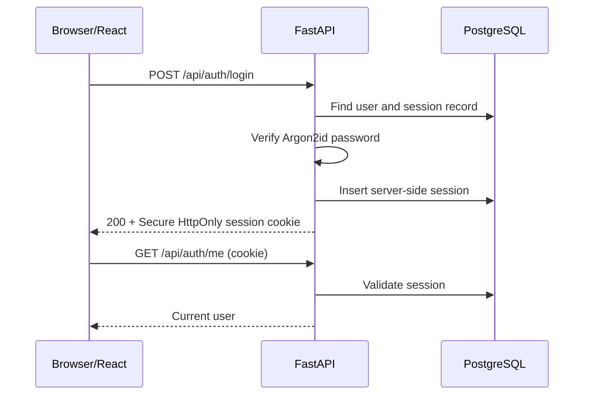
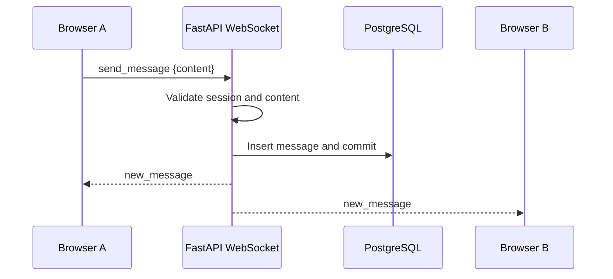
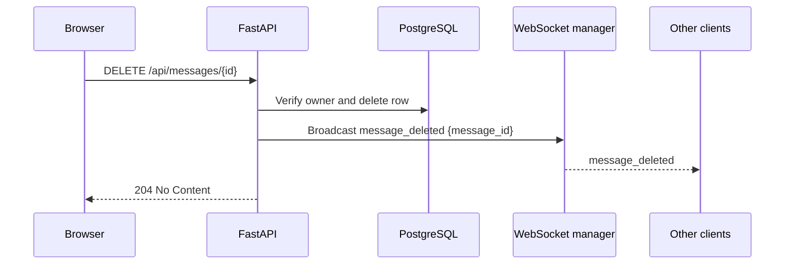

# Integration Engineering Guide

## 1. Purpose

This guide connects React, FastAPI, PostgreSQL, cookies, and WebSockets into one mental model for the six-member team.

## 2. Responsibility

Integration is shared. Member 1 owns infrastructure, Member 2 auth/security, Member 3 browser foundation, Member 4 WebSocket UI, Member 5 message/history behavior, and Member 6 cross-system verification. Each flow needs a primary owner and a partner reviewer.

## 3. Concepts first

Understand HTTP request/response, cookies, server-side sessions, REST, database transactions, WebSocket lifecycle, event contracts, cursor pagination, and server-authoritative state.

## 4. Tools

React/Tailwind, FastAPI, SQLAlchemy, Alembic, PostgreSQL, browser network tools, WebSocket inspection, API tests, database tests, and E2E tests.

## 5. Flows

### Registration

React submits `POST /api/auth/register`; FastAPI validates and hashes with Argon2id; PostgreSQL inserts a unique user; FastAPI returns the documented safe user shape. Owners: Members 2 and 1; collaborators: Members 3 and 6.

### Login and authenticated access

React submits `POST /api/auth/login`; FastAPI verifies Argon2id, creates a server session, stores only its credential hash, and sets a Secure HttpOnly cookie. React calls `/api/auth/me`, then opens the protected chat. Owners: Members 2 and 3; collaborators: Members 1, 4, and 6.

### History retrieval

React calls `GET /api/messages` with the documented cursor/limit parameters. FastAPI validates the session, queries PostgreSQL in stable cursor order, and returns messages plus the next cursor. Owners: Members 5 and 1; collaborators: Members 3, 4, and 6.

### Sending and persistence

The authenticated WebSocket sends `send_message`. FastAPI validates identity/content, inserts in a transaction, commits, then broadcasts `new_message` to connected clients. React reconciles by server ID. Owners: Members 5 and 4; collaborators: Members 1, 2, and 6.

### Deletion

React calls `DELETE /api/messages/{message_id}`. FastAPI checks the session and author, hard-deletes the row, then broadcasts `message_deleted`. Every client removes the matching ID. Owners: Members 5 and 4; collaborators: Members 2, 1, and 6.

### Presence

The connection manager adds an authenticated user when `/ws/chat` opens and removes the user only after their last active connection closes. It broadcasts `online_users`. Owner: Member 4 with Member 2; Member 6 tests multiple connections.

### Logout

React calls `POST /api/auth/logout`; FastAPI revokes the current session and clears the cookie. Future REST/WebSocket authentication fails. Owners: Members 2 and 3; collaborators: Members 4 and 6.

### Disconnect and reconnect

React marks the chat disconnected when the socket closes, retries according to the agreed client policy, and reloads history to recover messages that may have been missed. The server cleans presence on disconnect. Owners: Members 4 and 5; collaborators: Members 2 and 6.

## 6. Features to implement

Implement and verify registration, login/session establishment, authenticated route access, cursor history, message send/persistence/broadcast, hard deletion, online presence, logout, and disconnect/reconnect recovery. Keep each flow aligned with the REST and WebSocket contracts.

## 7. Sequence diagrams

### Login

### Message send

### Hard deletion

## 8. Expected components

The integration surface is the documented API client, auth state, protected route, history query, WebSocket client, FastAPI routes/services, auth dependency, connection manager, SQLAlchemy models/repositories, and migrations. Keep contracts explicit rather than sharing hidden implementation details.

## 9. Testing

Test every flow at its boundary and end to end: cookie/session auth, CSRF, history cursor, persistence-before-broadcast, hard deletion and ownership, presence counts, logout invalidation, reconnect/history recovery, and two-client delivery. Test failures and disconnects, not just happy paths.

## 10. Common mistakes

Do not open the socket before auth is established, treat a 204 as a message event, broadcast before commit, use a stale cursor after deletion, assume reconnect replays events, trust client user IDs, or update one contract without updating the others.

## 11. Security

Cookie credentials, CSRF, CORS, session revocation, WebSocket auth, ownership checks, safe errors, and secret-free logs must work together. A secure frontend cannot compensate for a backend authorization bug.

## 12. Acceptance criteria

The documented registration-to-logout path works; two authenticated clients share persisted messages and presence; history survives refresh; deletion is hard and synchronized; disconnect/reconnect has clear UI and recovery behavior; all ownership and tests are visible.

## 13. Questions

Which component owns each decision? What proves a message is persisted? How does the session reach a WebSocket? What data can be recovered after reconnect? Which tests cover two browser sessions? What happens if deletion succeeds but a client is disconnected?
